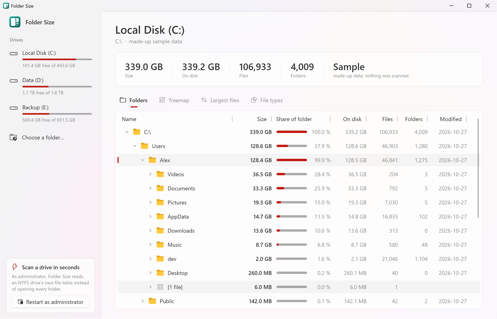
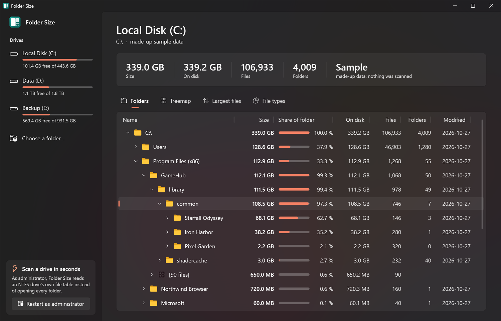
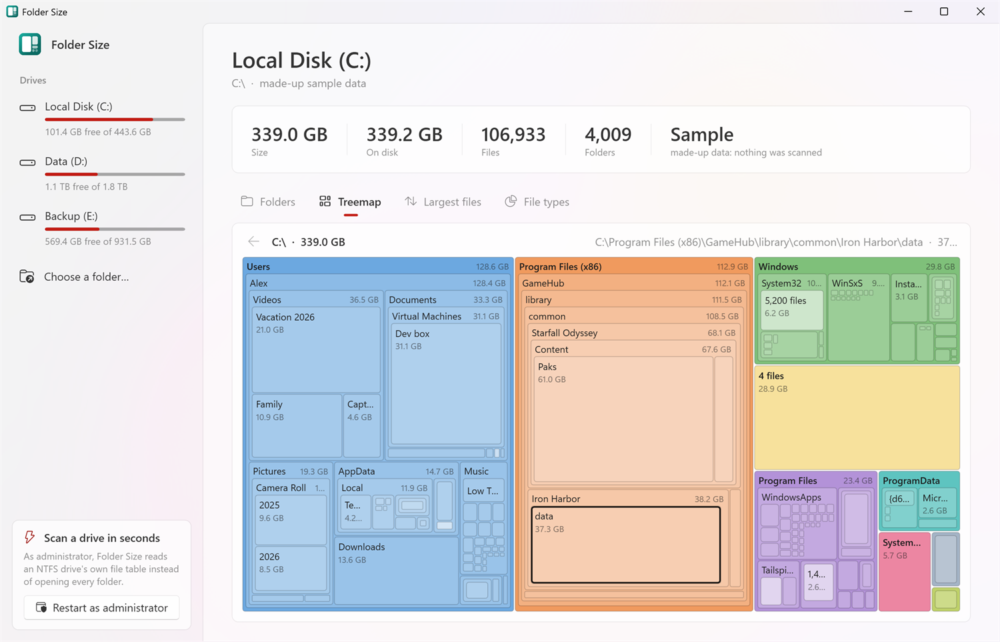
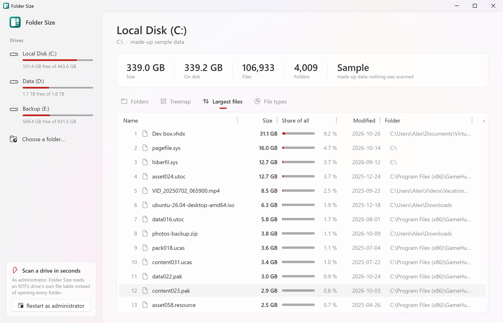
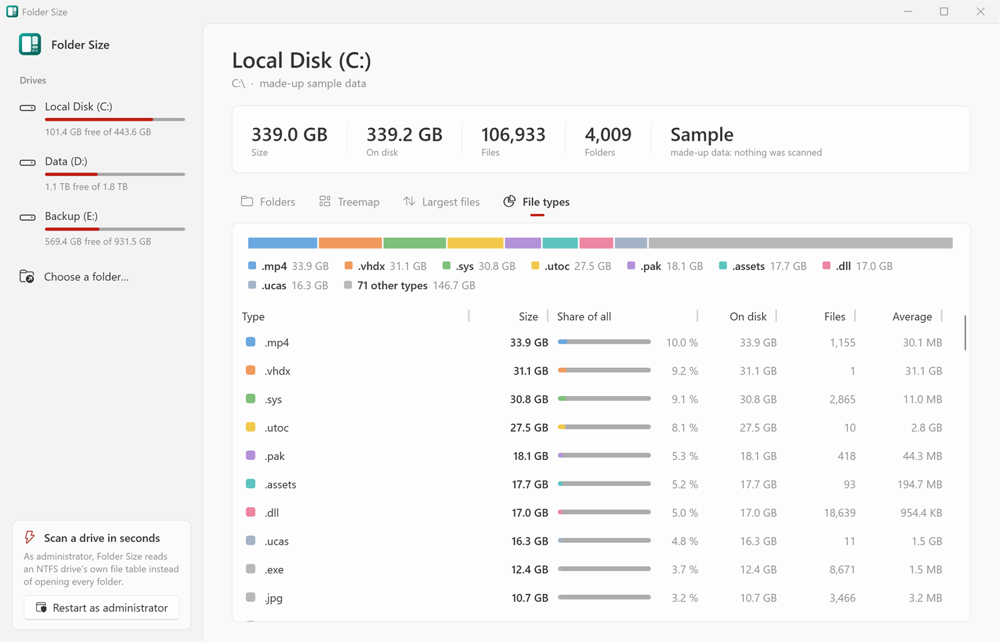

# folder-size

[](https://github.com/strongthium/folder-size/actions/workflows/release.yml)
[](https://github.com/strongthium/folder-size/releases/latest)
[](LICENSE)

`folder-size` is a Windows program that shows what takes up the space on a drive or in a folder: every folder under
it added up, largest first, as a tree, a treemap, the largest files and the space by file type. Run as administrator,
it reads an NTFS drive's own file table instead of opening every folder, and scans a whole drive in seconds.

It runs on Windows 10 and 11, is one file of about 400 KB with nothing to install, and sends nothing anywhere.



The drives down the side, each with how full it is; the totals of the scan; and the folders, largest first, each with
its share of the folder it's in. A folder's own files are one line, `[1 file]` or `[24 files]`, that opens to list them.

## A tour

The pictures are of made-up sample data (`folder-size --sample`): a PC with Windows, a few programs and games, and
the photos, videos and downloads of someone called Alex. The companies and programs in it are made up or open source.

### Folders



Down into a game library: 108.5 GB, nearly all of it two games. Click a column's heading to sort by it (size, size on
disk, files, folders, last change or name), and again to turn the order round. It follows Windows' light or dark mode
and accent colour.

### Treemap



Each folder a block as big as its share, coloured by the folder it's in at the top, with the folders in it inside it,
as deep as there's room for; a folder's own files are one paler block. The 28.9 GB block on its own is the 4 files at
the top of the drive (`pagefile.sys`, `hiberfil.sys`...). Click a block to go into that folder, **←** to come back
out, and right-click it for the same menu as in the list.

### Largest files



The 1,000 largest files of the scan, wherever they are: here a virtual machine's disk, the page and hibernation files,
a game's data and an `.iso` left in Downloads. A double-click shows the file in Explorer.

### File types



The space by extension: a bar of the eight largest and the rest, and every extension with how many files, the size,
the size on disk and the average file.

### What can be done with a folder or a file

Right-click any line (or treemap block) for:

| | |
|---|---|
| **Open** | the folder in Explorer, or the file with its program |
| **Show in Explorer** | its folder, with it selected |
| **Copy path** | |
| **Show in the treemap** | that folder, in the treemap |
| **Scan this folder** | a new scan of just that folder |
| **Move to the Recycle Bin…** | after asking, and with Windows' own progress; Windows asks again if it's too big for the bin. The totals, the treemap and the largest files are put right at once, without scanning again |

Nothing is ever deleted outright: it all goes to the Recycle Bin.

## Fast

Two ways of scanning, and it picks the faster one it's allowed:

| | When | How |
|---|---|---|
| **The file table** | the whole of a local NTFS drive, run as administrator | reads the drive's master file table (the MFT) straight from the volume, in 4 MB pieces, one read ahead while every processor picks the last apart. Every file and folder is a 1 KB record in it with its name, its folder and its size, so this is one big read instead of a million small ones |
| **Folder by folder** | any folder, any drive (USB, network), any rights | lists folders many at once, two threads a processor, each folder in one or two calls (`NtQueryDirectoryFile`, which gives every entry's size and size on disk together) |

On a 16-thread desktop PC, its C: drive of 650,000 files in 286,000 folders:

| | Time |
|---|---|
| The file table, as administrator | **1.4 s** (3.6 s the first time after starting Windows) |
| Folder by folder, 32 at once | 17 s |
| Folder by folder, one at a time, as most scanners do | 44 s |

**Restart as administrator** (bottom left) starts it again with the rights for the file table, and scans what was being
scanned. Windows asks first. Whatever the rights, a folder rather than a whole drive is scanned folder by folder.

It keeps folders, not files, so a scan of millions of files takes little memory (the file table scan of the drive
above: about 70 MB); a folder's files are read again when they're opened in the list.

## How it counts

| | |
|---|---|
| **Size** | the length of each file: what Explorer calls *Size* |
| **On disk** | the clusters each file takes: less than its size when it's compressed or sparse, more for many small files. A file of a few hundred bytes lives in NTFS's own record of it and takes no cluster: it's counted in 8s, as NTFS reports it |
| **Junctions, links and mount points** | aren't followed: what they point at is counted where it really is, so nothing is counted twice and a scan never loops |
| **Hard links** | one file with names in several folders (Windows' `WinSxS` and Edge's versions are full of them). Folder by folder, each name counts, as Explorer does. From the file table, each file counts once, in the folder of its first name, so the drive's total is what's really used |
| **What it can't read** | folder by folder, a folder it isn't allowed into is left out and marked *couldn't be read*, and the totals say how many there were. The file table has everything, `System Volume Information` (restore points) included |
| **Units** | as Windows writes them: in 1,024s, KB, MB, GB, TB |

## Using it

Download a zip from [Releases](../../releases/latest), or take the `.exe` straight from [`public/`](public), which
always holds the latest build: `folder-size-win-x64-needs-dotnet.exe`, about 400 KB, for Windows 10 and 11 on x64
PCs. It runs on the [.NET 10 Desktop Runtime](https://dotnet.microsoft.com/download/dotnet/10.0) installed on the PC,
which Microsoft Update keeps patched. Without it, Windows offers to download it.

The program is small because it draws with what Windows and .NET already have: WPF, with Windows 11's own look (light
or dark, in your accent colour).

Run it, and click a drive, or **Choose a folder…**. **Scan again** scans the same again; **Up** scans the folder it's
in; **Stop** stops a scan.

From the command line:

```
folder-size D:\Photos                     # scans that folder at once
folder-size --sample                      # the made-up PC of the pictures, nothing scanned
folder-size --theme dark                  # light or dark, rather than following Windows
folder-size --sample --view treemap       # opens on folders, treemap, largest or types
folder-size --sample --expand Users\Alex  # opens the folders down to that one
```

## Your data

Nothing is sent anywhere and nothing is saved: a scan lives in memory until the window is closed. The only change it
ever makes to the disk is moving what you choose to the Recycle Bin.

## Building

You need Windows and the [.NET 10 SDK](https://dotnet.microsoft.com/download).

```
.\build.ps1                 # tests, then the program into public\  (or double-click build.cmd)
.\build.ps1 -Bump patch     # the same as a new version: 1.0.0 -> 1.0.1
```

`build.ps1` runs the tests (`-SkipTests` skips them), publishes the program, and replaces what's in
[`public/`](public) with it, its `SHA256SUMS` and the `VERSION` it was built as.

The version is in [`VERSION`](VERSION), `major.minor.patch`, and every build reads it. `-Bump major|minor|patch` or
`-Version 2.0.0` builds a new one, and `VERSION` is changed once that build has succeeded, so the version in the
repository is always the one in `public/`.

For working on it:

```
dotnet build
dotnet test
dotnet run --project src/FolderSize -- --sample
```

| Folder | What's in it |
|---|---|
| [`src/FolderSize.Core`](src/FolderSize.Core) | the two scans (the file table read from the volume, and folders listed in parallel), reading the file table's records, what a scan found, the treemap's layout, the sizes, the sample data |
| [`src/FolderSize`](src/FolderSize) | the window (WPF, with its Fluent theme): the drives, the folder tree, the treemap, the largest files and the file types |
| [`tests/FolderSize.Tests`](tests/FolderSize.Tests) | tests of the core: the folder scan on folders it makes, and file table records made byte by byte, since reading a real volume needs administrator rights |
| [`public`](public) | the latest build, made by `build.ps1` |
| [`build.ps1`](build.ps1), [`build.cmd`](build.cmd), [`VERSION`](VERSION) | the builder, and the version it builds |

`master` holds the source. A push to `deploy` (a merge into it counts) runs
[`.github/workflows/release.yml`](.github/workflows/release.yml), which:

1. runs the tests on Windows;
2. builds the x64 program, one `.exe`;
3. publishes release `v<VERSION>` with its zip and `SHA256SUMS`. A version is released once: to release
   again, raise it first (`build.ps1 -Bump patch`).

## License

MIT, see [LICENSE](LICENSE).
